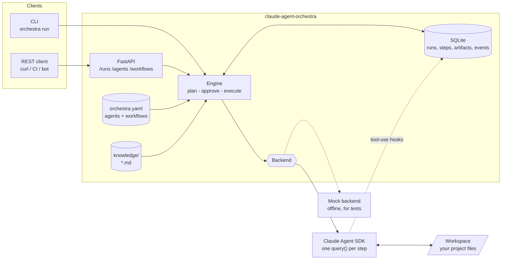
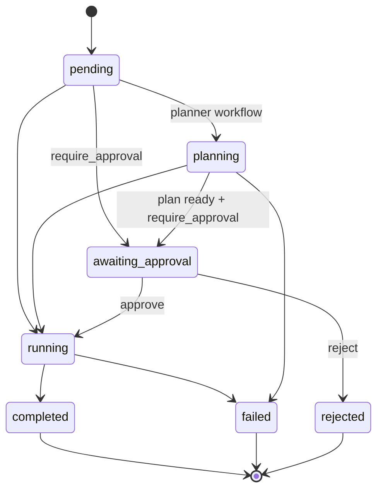

# claude-agent-orchestra

**A small, self-hostable multi-agent orchestrator for the [Claude Agent SDK](https://docs.claude.com/en/api/agent-sdk/overview).**
Define a team of specialist agents in YAML, run goals through task pipelines (or let a planner agent decide the steps), gate risky work behind human approval, and keep a full history of runs, outputs and tool calls behind a REST API and CLI.

[English](README.md) | [Русский](README.ru.md)

[](https://github.com/cyxar4uk/claude-agent-orchestra/actions/workflows/ci.yml)
[](LICENSE)


## The problem

The Claude Agent SDK gives you one very capable agent loop. Real projects quickly need more around it:

- several **roles** (analyst, architect, implementer, reviewer) with different prompts, models and *tool permissions*;
- a repeatable **pipeline** instead of one giant prompt, where each step sees the previous step's output;
- a **human approval gate** before anything is allowed to edit files;
- **persistence**: what ran, in which order, with which model, at what cost, and which tools it touched;
- shared **project knowledge** every agent can rely on;
- a **service** other tools can call (CI, chat bots, dashboards), not just a script.

`claude-agent-orchestra` is that thin layer, and nothing more: one Python package, SQLite for state, no Redis or Postgres, no hardcoded domain. Roles, prompts and workflows are configuration.

## Architecture



Run lifecycle:



## Features

- **Agent roles as config**: name, description, system prompt (inline or a Markdown file), model, allowed tools, permission mode, turn limit.
- **Two workflow modes**: fixed `pipeline` of steps with `{{ goal }}`, `{{ previous }}` and `{{ steps.<id> }}` templating, or `planner` mode where a planner agent writes the plan (validated JSON, only from an allowed roster).
- **Least-privilege tools**: each agent only sees the built-in tools listed for it. The default workflow is entirely read-only.
- **Approval gates**: `require_approval` pauses after planning and before any step executes; approve or reject over HTTP or the CLI.
- **Run history**: runs, steps (model, cost, session id, timings), artifacts and a tool-use audit trail in SQLite; artifacts are also mirrored to `data/runs/<id>/*.md`.
- **Knowledge base**: drop `.md`/`.txt` files in a folder; they are injected into every agent's prompt.
- **Current models by default**: `claude-sonnet-5-5` for workers, optional `claude-opus-5-5` for planners. Model IDs are plain strings in `.env`/YAML.
- **REST API + CLI** with optional bearer-token auth.
- **Testable**: a deterministic mock backend means your workflows can be tested without an API key.
- **Docker**: `docker compose up` and you have a service.

## Quick start

### Option A: local install

```bash
git clone https://github.com/cyxar4uk/claude-agent-orchestra.git
cd claude-agent-orchestra
python -m venv .venv && source .venv/bin/activate      # Windows: .venv\Scripts\activate
pip install -e ".[dev]"

# Try it offline first: no API key, no cost
orchestra run --mock "Add rate limiting to the public API"
python examples/quickstart/run.py

# Real Claude calls
cp .env.example .env            # then set ANTHROPIC_API_KEY
orchestra run "Add rate limiting to the public API" --workspace /path/to/your/project
```

### Option B: Docker

```bash
cp .env.example .env            # set ANTHROPIC_API_KEY and ORCHESTRA_WORKSPACE_HOST=/path/to/your/project
docker compose up --build
curl localhost:8000/health
```

Try the whole flow without an API key: `ORCHESTRA_BACKEND=mock docker compose up --build`.

### Run something through the API

```bash
# Read-only planning pipeline (analyst -> architect -> reviewer); waits for the result
curl -s -X POST "localhost:8000/runs?wait=true" \
  -H 'content-type: application/json' \
  -d '{"goal": "Add rate limiting to the public API"}'

# A workflow that edits files and needs your approval first
curl -s -X POST "localhost:8000/runs?wait=true" \
  -H 'content-type: application/json' \
  -d '{"goal": "Add rate limiting to the public API", "workflow": "implement"}'
# -> status: awaiting_approval; inspect the plan, then:
curl -s -X POST "localhost:8000/runs/<run_id>/approve"      # or /reject
curl -s localhost:8000/runs/<run_id>/artifacts
```

Interactive docs are served at `http://localhost:8000/docs`.

## Configuration

### Environment (`.env`)

| Variable | Default | Meaning |
| --- | --- | --- |
| `ANTHROPIC_API_KEY` | none | Credentials for the `claude` backend |
| `ORCHESTRA_BACKEND` | `claude` | `claude` or `mock` (offline) |
| `ORCHESTRA_WORKER_MODEL` | `claude-sonnet-5-5` | Model for agents with `model: worker` |
| `ORCHESTRA_PLANNER_MODEL` | empty | Model for `model: planner` agents, e.g. `claude-opus-5-5`; empty means the worker model |
| `ORCHESTRA_CONFIG` | built-in | Path to your `orchestra.yaml` |
| `ORCHESTRA_WORKSPACE` | `.` | Directory the agents read and edit |
| `ORCHESTRA_DATA_DIR` | `data` | SQLite database and run artifacts |
| `ORCHESTRA_PERMISSION_MODE` | `acceptEdits` | Claude Agent SDK permission mode |
| `ORCHESTRA_MAX_TURNS` | `30` | Turn limit per step |
| `ORCHESTRA_MAX_BUDGET_USD` | none | Spend cap per step |
| `ORCHESTRA_MAX_CONCURRENT_RUNS` | `2` | Runs executing in parallel |
| `ORCHESTRA_API_TOKEN` | empty | If set, all endpoints except `/health` require `Authorization: Bearer <token>` |
| `ORCHESTRA_HOST` / `ORCHESTRA_PORT` | `127.0.0.1` / `8000` | API bind address |

### `orchestra.yaml`

```yaml
knowledge_dir: knowledge          # optional, relative to this file
default_workflow: feature-planning

agents:
  analyst:
    description: Clarifies requirements and acceptance criteria.
    prompt_file: prompts/analyst.md     # or `prompt: |` inline
    model: worker                       # worker | planner | any model ID
    tools: [Read, Glob, Grep]           # built-in tools this agent may use

workflows:
  feature-planning:
    steps:
      - id: requirements
        agent: analyst
        task: "Goal: {{ goal }}. Write requirements."
      - id: design
        agent: architect
        task: "Design this: {{ steps.requirements }}"
    # require_approval: true            # pause before executing

  auto:                                  # planner mode
    mode: planner
    planner: planner
    agents: [analyst, architect, implementer, reviewer]
    max_steps: 5
    require_approval: true
```

The built-in defaults live in [`src/orchestra/defaults/`](src/orchestra/defaults/); [`examples/`](examples/) has a minimal config and a domain-specific "game studio" team.

## API overview

| Method | Path | Description |
| --- | --- | --- |
| `GET` | `/health` | Liveness, version, active backend (no auth) |
| `GET` | `/agents` | Configured agents with resolved model IDs |
| `GET` | `/workflows` | Configured workflows |
| `GET` | `/knowledge` | Files in the knowledge base |
| `POST` | `/runs` | Create and start a run. Body: `goal`, optional `workflow`, `require_approval`. `?wait=true` blocks until done or awaiting approval |
| `GET` | `/runs` | Recent runs (`?status=`, `?limit=`) |
| `GET` | `/runs/{id}` | Run with steps, outputs and total cost |
| `GET` | `/runs/{id}/events` | Event log, including tool calls (`?after_id=` for polling) |
| `GET` | `/runs/{id}/artifacts` | Per-step outputs, the plan and the aggregated result |
| `POST` | `/runs/{id}/approve` | Resume a run that is `awaiting_approval` (`?wait=true`) |
| `POST` | `/runs/{id}/reject` | Reject it. Body: optional `reason` |

CLI: `orchestra run | serve | agents | workflows | runs | show`. Add `--mock` to any `run`/`serve` for offline mode.

## Extending with your own agents

1. Copy `examples/quickstart/orchestra.yaml` somewhere and point `ORCHESTRA_CONFIG` at it.
2. Add an agent. Give it the smallest tool set that works:

   ```yaml
   agents:
     security-auditor:
       description: Looks for injection, auth and secrets issues.
       prompt: |
         You audit code for security problems. Cite file and line for every finding.
       tools: [Read, Glob, Grep]
       model: planner
   ```
3. Use it in a workflow step, or add it to the `agents:` roster of a planner workflow.
4. Put background material in `knowledge/*.md`.
5. Test it offline: `orchestra run --mock -c orchestra.yaml -w my-workflow "..."`.

To use a different execution engine, implement the two-line `Backend` protocol in [`src/orchestra/backends/base.py`](src/orchestra/backends/base.py) (`async def run_step(request) -> StepResult`).

## Safety notes

- Agents run real tools in your workspace. Only agents that list `Write`, `Edit` or `Bash` can change anything; the default `feature-planning` workflow lists none.
- `ORCHESTRA_PERMISSION_MODE=acceptEdits` auto-approves edits for the tools an agent lists. Use `require_approval` for anything that writes, and run the service in Docker or a throwaway checkout.
- The API binds to `127.0.0.1` by default. If you expose it, set `ORCHESTRA_API_TOKEN` and put it behind TLS. See [SECURITY.md](SECURITY.md).

## Roadmap

- [ ] Server-sent events stream for live run output
- [ ] Parallel step groups (fan-out / fan-in)
- [ ] Per-step retry and resume of failed runs
- [ ] Run cancellation
- [ ] Minimal web UI (run list, approval screen, event timeline)
- [ ] Conditional steps and structured (JSON-schema) step outputs
- [ ] Webhook notifications (Slack, Telegram) on approval requests
- [ ] Postgres option for multi-instance deployments

## Development

```bash
pip install -e ".[dev]"
ruff check . && ruff format --check .
pytest            # no API key needed; the LLM backend is mocked
```

## Contributing

Issues and pull requests are welcome. Read [CONTRIBUTING.md](CONTRIBUTING.md) first; it is short.

## License

[MIT](LICENSE) (c) 2026 Ilia Melnikov
