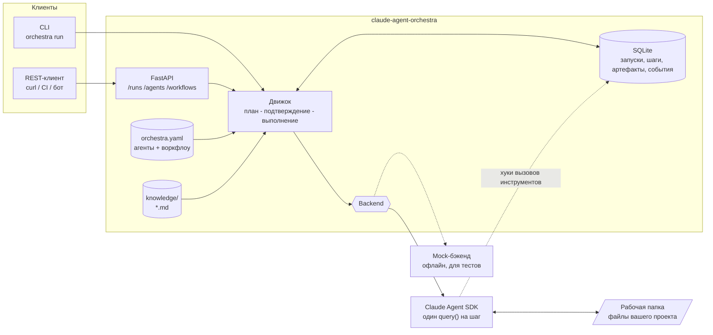

# claude-agent-orchestra

**Небольшой самохостируемый оркестратор мультиагентных систем на базе [Claude Agent SDK](https://docs.claude.com/en/api/agent-sdk/overview).**
Описываете команду агентов-специалистов в YAML, прогоняете цели через пайплайны задач (или даёте планировщику самому выбрать шаги), ставите рискованные операции за ручное подтверждение и получаете полную историю запусков, результатов и вызовов инструментов через REST API и CLI.

[English](README.md) | [Русский](README.ru.md)

[](https://github.com/cyxar4uk/claude-agent-orchestra/actions/workflows/ci.yml)
[](LICENSE)


## Какую проблему решает

Claude Agent SDK даёт один очень сильный агентный цикл. В реальном проекте быстро появляется потребность в большем:

- несколько **ролей** (аналитик, архитектор, разработчик, ревьюер) с разными промптами, моделями и **правами на инструменты**;
- повторяемый **пайплайн** вместо одного гигантского промпта: каждый шаг видит результат предыдущего;
- **ручное подтверждение** до того, как кому-либо разрешат править файлы;
- **история**: что и в каком порядке запускалось, на какой модели, сколько стоило и какие инструменты были вызваны;
- общая **база знаний** проекта, доступная всем агентам;
- **сервис**, который можно вызвать из CI, чат-бота или дашборда, а не только скрипт.

`claude-agent-orchestra` - это тонкий слой ровно для этого и ничего больше: один Python-пакет, SQLite для состояния, без Redis и Postgres, без зашитой предметной области. Роли, промпты и воркфлоу - это конфигурация.

## Архитектура



## Возможности

- **Роли агентов в конфиге**: имя, описание, системный промпт (в YAML или в Markdown-файле), модель, разрешённые инструменты, режим прав, лимит ходов.
- **Два режима воркфлоу**: фиксированный `pipeline` с шаблонами `{{ goal }}`, `{{ previous }}`, `{{ steps.<id> }}` или режим `planner`, где агент-планировщик сам составляет план (проверяемый JSON, только из разрешённого списка агентов).
- **Минимум привилегий**: агент видит только перечисленные для него встроенные инструменты. Воркфлоу по умолчанию полностью read-only.
- **Подтверждение**: `require_approval` ставит запуск на паузу после планирования и до выполнения любого шага; подтвердить или отклонить можно по HTTP или в CLI.
- **История запусков**: запуски, шаги (модель, стоимость, session id, время), артефакты и аудит вызовов инструментов в SQLite; артефакты дублируются в `data/runs/<id>/*.md`.
- **База знаний**: положите `.md`/`.txt` в папку - они попадут в промпт каждого агента.
- **Актуальные модели по умолчанию**: `claude-sonnet-5-5` для исполнителей, опционально `claude-opus-5-5` для планировщика. ID моделей - обычные строки в `.env`/YAML.
- **REST API и CLI** с необязательной авторизацией по bearer-токену.
- **Тестируемость**: детерминированный mock-бэкенд позволяет проверять воркфлоу без API-ключа.
- **Docker**: `docker compose up` - и сервис работает.

## Быстрый старт

### Вариант A: локальная установка

```bash
git clone https://github.com/cyxar4uk/claude-agent-orchestra.git
cd claude-agent-orchestra
python -m venv .venv && source .venv/bin/activate      # Windows: .venv\Scripts\activate
pip install -e ".[dev]"

# Сначала попробуйте офлайн: без ключа и без затрат
orchestra run --mock "Добавить rate limiting в публичный API"
python examples/quickstart/run.py

# Реальные вызовы Claude
cp .env.example .env            # впишите ANTHROPIC_API_KEY
orchestra run "Добавить rate limiting в публичный API" --workspace /path/to/your/project
```

### Вариант B: Docker

```bash
cp .env.example .env            # ANTHROPIC_API_KEY и ORCHESTRA_WORKSPACE_HOST=/path/to/your/project
docker compose up --build
curl localhost:8000/health
```

Проверить весь поток без ключа: `ORCHESTRA_BACKEND=mock docker compose up --build`.

### Запуск через API

```bash
# Read-only пайплайн планирования (analyst -> architect -> reviewer), ждём результат
curl -s -X POST "localhost:8000/runs?wait=true" \
  -H 'content-type: application/json' \
  -d '{"goal": "Добавить rate limiting в публичный API"}'

# Воркфлоу, который правит файлы и сначала просит подтверждения
curl -s -X POST "localhost:8000/runs?wait=true" \
  -H 'content-type: application/json' \
  -d '{"goal": "Добавить rate limiting в публичный API", "workflow": "implement"}'
# -> status: awaiting_approval; посмотрите план, затем:
curl -s -X POST "localhost:8000/runs/<run_id>/approve"      # или /reject
curl -s localhost:8000/runs/<run_id>/artifacts
```

Интерактивная документация: `http://localhost:8000/docs`.

## Конфигурация

Основные переменные окружения (полный список - в [`.env.example`](.env.example)):

| Переменная | По умолчанию | Назначение |
| --- | --- | --- |
| `ANTHROPIC_API_KEY` | нет | Ключ для бэкенда `claude` |
| `ORCHESTRA_BACKEND` | `claude` | `claude` или `mock` (офлайн) |
| `ORCHESTRA_WORKER_MODEL` | `claude-sonnet-5-5` | Модель для агентов с `model: worker` |
| `ORCHESTRA_PLANNER_MODEL` | пусто | Модель для `model: planner`, например `claude-opus-5-5`; пусто - модель исполнителя |
| `ORCHESTRA_CONFIG` | встроенный | Путь к вашему `orchestra.yaml` |
| `ORCHESTRA_WORKSPACE` | `.` | Папка, где агенты читают и правят файлы |
| `ORCHESTRA_DATA_DIR` | `data` | База SQLite и артефакты запусков |
| `ORCHESTRA_PERMISSION_MODE` | `acceptEdits` | Режим прав Claude Agent SDK |
| `ORCHESTRA_API_TOKEN` | пусто | Если задан, все эндпоинты кроме `/health` требуют `Authorization: Bearer <token>` |

Пример `orchestra.yaml`:

```yaml
default_workflow: feature-planning

agents:
  analyst:
    description: Уточняет требования и критерии приёмки.
    prompt_file: prompts/analyst.md     # или `prompt: |` прямо в YAML
    model: worker                       # worker | planner | любой ID модели
    tools: [Read, Glob, Grep]           # встроенные инструменты, доступные агенту

workflows:
  feature-planning:
    steps:
      - id: requirements
        agent: analyst
        task: "Цель: {{ goal }}. Составь требования."
      - id: design
        agent: architect
        task: "Спроектируй: {{ steps.requirements }}"
    # require_approval: true            # пауза перед выполнением
```

Встроенные значения по умолчанию лежат в [`src/orchestra/defaults/`](src/orchestra/defaults/), а в [`examples/`](examples/) есть минимальный конфиг и предметно-ориентированная команда "игровая студия".

## Обзор API

| Метод | Путь | Описание |
| --- | --- | --- |
| `GET` | `/health` | Состояние, версия, активный бэкенд (без авторизации) |
| `GET` | `/agents` | Агенты с итоговыми ID моделей |
| `GET` | `/workflows` | Воркфлоу |
| `GET` | `/knowledge` | Файлы базы знаний |
| `POST` | `/runs` | Создать и запустить. Тело: `goal`, опционально `workflow`, `require_approval`. `?wait=true` - ждать завершения или подтверждения |
| `GET` | `/runs` | Последние запуски (`?status=`, `?limit=`) |
| `GET` | `/runs/{id}` | Запуск с шагами, результатами и суммарной стоимостью |
| `GET` | `/runs/{id}/events` | Журнал событий, включая вызовы инструментов |
| `GET` | `/runs/{id}/artifacts` | Результаты шагов, план и итоговый отчёт |
| `POST` | `/runs/{id}/approve` | Продолжить запуск в статусе `awaiting_approval` |
| `POST` | `/runs/{id}/reject` | Отклонить. Тело: опционально `reason` |

CLI: `orchestra run | serve | agents | workflows | runs | show`. Флаг `--mock` включает офлайн-режим.

## Как добавить своих агентов

1. Скопируйте `examples/quickstart/orchestra.yaml` и укажите путь в `ORCHESTRA_CONFIG`.
2. Добавьте агента, выдав ему минимально нужный набор инструментов:

   ```yaml
   agents:
     security-auditor:
       description: Ищет проблемы с инъекциями, авторизацией и секретами.
       prompt: |
         Ты аудируешь код на уязвимости. Для каждой находки указывай файл и строку.
       tools: [Read, Glob, Grep]
       model: planner
   ```
3. Используйте его в шаге воркфлоу или добавьте в список `agents:` planner-воркфлоу.
4. Фоновые знания кладите в `knowledge/*.md`.
5. Проверьте офлайн: `orchestra run --mock -c orchestra.yaml -w my-workflow "..."`.

Чтобы использовать другой исполняющий движок, реализуйте протокол `Backend` из [`src/orchestra/backends/base.py`](src/orchestra/backends/base.py).

## Безопасность

- Агенты запускают реальные инструменты в вашей рабочей папке. Менять файлы могут только агенты с `Write`, `Edit` или `Bash`; в воркфлоу `feature-planning` таких нет.
- `ORCHESTRA_PERMISSION_MODE=acceptEdits` автоматически разрешает правки для инструментов агента. Для всего, что пишет, используйте `require_approval` и запускайте сервис в Docker или во временной копии репозитория.
- API по умолчанию слушает `127.0.0.1`. Если открываете наружу - задайте `ORCHESTRA_API_TOKEN` и поставьте TLS-прокси. Подробнее в [SECURITY.md](SECURITY.md).

## Дорожная карта

- [ ] Потоковая выдача результата (SSE)
- [ ] Параллельные группы шагов (fan-out / fan-in)
- [ ] Повтор шага и возобновление упавших запусков
- [ ] Отмена запуска
- [ ] Минимальный веб-интерфейс (список запусков, экран подтверждения, лента событий)
- [ ] Условные шаги и структурированные (JSON Schema) результаты шагов
- [ ] Уведомления (Slack, Telegram) о запросах на подтверждение
- [ ] Postgres для нескольких инстансов

## Разработка

```bash
pip install -e ".[dev]"
ruff check . && ruff format --check .
pytest            # API-ключ не нужен: LLM-бэкенд замокан
```

## Участие в проекте

Issues и pull request'ы приветствуются. Сначала прочитайте короткий [CONTRIBUTING.md](CONTRIBUTING.md).

## Лицензия

[MIT](LICENSE) (c) 2026 Ilia Melnikov
